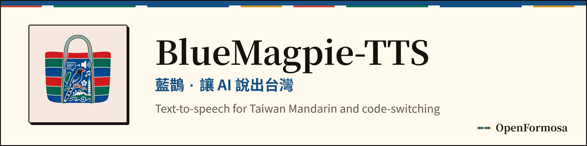
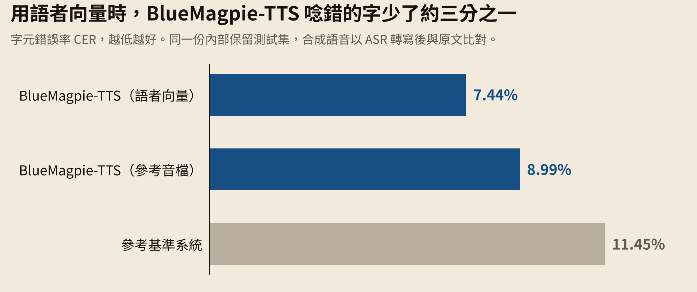

<p align="center"></p>

# BlueMagpie-TTS

BlueMagpie-TTS is an open text-to-speech model for Taiwan Mandarin and Mandarin–English code-switching, with 48 kHz output. On the same internal test set, its character error rate is 7.44%, versus 11.45% for a reference baseline.

<p align="center">
  <a href="#license"></a>
  <a href="https://huggingface.co/OpenFormosa/BlueMagpie-TTS"></a>
  <a href="https://huggingface.co/spaces/voidful/BlueMagpie-TTS-Demo"></a>
  
  <a href="https://discord.gg/N4YnrjjcW7"></a>
</p>

<p align="center"><a href="README.md">繁體中文</a> · <b>English</b></p>

<p align="center">
  <a href="https://huggingface.co/spaces/voidful/BlueMagpie-TTS-Demo">Try it</a> · <a href="https://colab.research.google.com/github/OpenFormosa/BlueMagpie-TTS/blob/main/notebooks/BlueMagpie_TTS_Colab.ipynb">Colab</a> · <a href="https://huggingface.co/OpenFormosa/BlueMagpie-TTS">Model</a> · <a href="USAGE.md">Full usage guide</a> · <a href="https://openformosa.com/community/">Community</a>
</p>

## Why

People in Taiwan often mix Mandarin and English in one sentence, such as 「這個 feature 明天上線」 ("this feature ships tomorrow"). Many TTS models misread the English or pause unnaturally on such sentences. Users end up rewriting them in all-Chinese first.

BlueMagpie-TTS handles these sentences as written. With the bundled speaker vectors, misread characters drop from about 11 to 7 per 100.

The full name is OpenFormosa Blue Magpie TTS, after the Taiwan blue magpie (*Urocissa caerulea*), a loud and easily recognized bird. It fits a model that turns text into voice.

## Quick start

Prefer not to install locally? Open the [Colab notebook](https://colab.research.google.com/github/OpenFormosa/BlueMagpie-TTS/blob/main/notebooks/BlueMagpie_TTS_Colab.ipynb) and run these steps on a free GPU.

1. Install (Python 3.10 to 3.12):

   ```bash
   git clone https://github.com/OpenFormosa/BlueMagpie-TTS
   cd BlueMagpie-TTS
   pip install -e .
   pip install soundfile        # for writing .wav files
   ```

2. Synthesize your first sentence (the first run downloads about 8 GB):

```python
import os
import torch
import soundfile as sf
from huggingface_hub import snapshot_download
from transformers import PreTrainedTokenizerFast
from bluemagpie import BlueMagpieModel

model_dir = snapshot_download("OpenFormosa/BlueMagpie-TTS")

# Load the tokenizer straight from tokenizer.json (works on transformers 5.x).
tokenizer = PreTrainedTokenizerFast(tokenizer_file=os.path.join(model_dir, "tokenizer.json"))

device = "cuda" if torch.cuda.is_available() else ("mps" if torch.backends.mps.is_available() else "cpu")
model = BlueMagpieModel.from_local(model_dir, tokenizer=tokenizer, training=False, device=device)

# Use a bundled (licensed) speaker vector for a stable voice on the first try.
table = torch.load(os.path.join(model_dir, "checkpoints", "speaker_centroids.pt"),
                   map_location="cpu", weights_only=True)
centroid = table["centroids"][table["speaker_ids"].index("hung_yi_lee")]

audio = model.generate(
    target_text="你好，這是 BlueMagpie 合成的第一句話。",
    speaker_centroid=centroid,
    cfg_value=2.0,
)
sf.write("hello.wav", audio.squeeze().cpu().numpy(), model.sample_rate)
print("wrote hello.wav")
```

3. Open `hello.wav` and you will hear 「你好，這是 BlueMagpie 合成的第一句話。」 If something fails, see [Troubleshooting](USAGE.md#troubleshooting).

The install pulls in the [`barbet`](https://github.com/OpenFormosa/Barbet)
package (the text-semantic language model) from GitHub. The acoustic modules are
vendored in `bluemagpie/_vendor/` (sourced from
[VoxCPM](https://github.com/OpenBMB/VoxCPM), Apache-2.0) and need no separate
install.

## Installation

| Item | Requirement |
| --- | --- |
| Python | **3.10 – 3.12** (3.13 not yet supported) |
| OS | Linux, macOS (Windows untested) |
| Key dependencies | PyTorch ≥ 2.1, transformers ≥ 4.44 (5.x works), numpy ≥ 1.26 and < 2.4 |
| Model download | ~8 GB (fetched automatically on first run) |
| Hugging Face account | **Not required** (the model is public, not gated) |

| Hardware | Supported | How | Speed* |
| --- | :-: | --- | --- |
| NVIDIA GPU (CUDA) | ✅ | `device="cuda"` | fastest |
| Apple Silicon (MLX, optional) | ✅ | `pip install -e .[mlx]`, see [MLX](USAGE.md#apple-silicon-mlx-acceleration-optional) | RTF ≈ 0.77 (faster than real time) |
| Apple Silicon (MPS) | ✅ | `device="mps"` | RTF ≈ 1.1 |
| CPU | ✅ | `device="cpu"`, see [Running on CPU](#running-on-cpu) | RTF ≈ 2.5 |

<sub>* RTF (real-time factor) = compute seconds per second of synthesized audio;
below 1 is faster than real time. Measured with `scripts/bench_rtf.py` on Apple
M-series, fp32; your hardware will differ.</sub>

Feature support per interface:

| Feature | `generate` | `generate_streaming` | batch engine | MLX |
| --- | :-: | :-: | :-: | :-: |
| Plain synthesis | ✅ | ✅ | ✅ | ✅ |
| Voice cloning (reference clip) | ✅ | ✅ | ✅ | ✅ |
| Voice cloning / speaker selection (speaker vector) | ✅ | ✅ | ✅ | ✅ |
| Continuation (prompt audio) | ✅ | ✅ | ✅ (latents-only when streaming) | ✅ |
| Auto-retry (`retry_badcase`) | ✅ |, |, |, |

### Running on CPU

No GPU required, set `device="cpu"` when loading; everything else is the same:

```python
model = BlueMagpieModel.from_local(model_dir, tokenizer=tokenizer, training=False, device="cpu")
```

- **Speed:** RTF ≈ 2.5, about 2.5 compute seconds per second of audio
  (measured on Apple M-series; x86 varies with core count). A 10-and-some
  character sentence finishes in roughly fifteen seconds.
- For long texts, split into sentences and synthesize incrementally (see
  [Streaming output](#streaming-output)) so the first sentence plays sooner.
- On Apple Silicon, prefer the [MLX path](USAGE.md#apple-silicon-mlx-acceleration-optional)
  (~3.3× faster than CPU, faster than real time).

## Usage

| Feature | What it does | Where |
| --- | --- | --- |
| Plain synthesis | Read text aloud | [Basic synthesis](#basic-synthesis) below |
| Voice cloning (no transcript) | Mimic a speaker from a 3 s+ reference clip | [USAGE.md](USAGE.md#voice-cloning-mimic-a-reference-speaker) |
| Speaker selection | Control timbre with a bundled or your own speaker vector | [USAGE.md](USAGE.md#speaker-selection-control-timbre-with-a-speaker-vector) |
| Speech continuation | Continue from existing speech and its text | [Four input modes](#four-input-modes) below |
| Streaming | Play while synthesizing | [Streaming output](#streaming-output) below |
| Batch serving engine | Continuous batching for higher throughput | [USAGE.md](USAGE.md#batch-serving-engine-multi-request-acceleration) |
| Apple Silicon acceleration | Native MLX inference, faster than real time on M-series | [USAGE.md](USAGE.md#apple-silicon-mlx-acceleration-optional) |

### Load the model

**From Hugging Face**

```python
import os
from huggingface_hub import snapshot_download
from transformers import PreTrainedTokenizerFast
from bluemagpie import BlueMagpieModel

model_dir = snapshot_download("OpenFormosa/BlueMagpie-TTS")
# Load the tokenizer straight from tokenizer.json (works on transformers 5.x).
tokenizer = PreTrainedTokenizerFast(tokenizer_file=os.path.join(model_dir, "tokenizer.json"))
model = BlueMagpieModel.from_local(model_dir, tokenizer=tokenizer, training=False, device="cuda")
```

The model is public, no token or access request is needed to download it.

**From a local directory**

```python
import os
from transformers import PreTrainedTokenizerFast
from bluemagpie import BlueMagpieModel

model_dir = "checkpoints/bluemagpie"
tokenizer = PreTrainedTokenizerFast(tokenizer_file=os.path.join(model_dir, "tokenizer.json"))
model = BlueMagpieModel.from_local(model_dir, tokenizer=tokenizer, training=False, device="cuda")
```

- `device` may be `"cuda"`, `"mps"`, or `"cpu"` (auto-selected if omitted).
- Always use `training=False` for inference.

### Basic synthesis

`generate` returns a speech waveform (`torch.Tensor`); pair it with `soundfile`
to write a `.wav`. The output sample rate is `model.sample_rate` (48 kHz).

```python
import soundfile as sf

audio = model.generate(target_text="今天天氣真好。", cfg_value=2.0)
sf.write("output.wav", audio.squeeze().cpu().numpy(), model.sample_rate)
```

### Streaming output

When you need to play while synthesizing, use `generate_streaming`. It is a
generator that yields audio chunks one at a time:

```python
chunks = []
for chunk in model.generate_streaming(target_text="今天天氣真好。"):
    chunks.append(chunk)
    # play or write each chunk in real time here
```

> Note: automatic retry (`retry_badcase`) is not supported in streaming mode.

### Four input modes

The model supports four input combinations through the same `generate` interface:

| Mode | Parameters | Use |
|---|---|---|
| Plain synthesis | `target_text` | Read the text aloud |
| Continuation | `target_text`, `prompt_text`, `prompt_wav_path` | Continue from an existing clip and its text |
| Reference clip | `target_text`, `reference_wav_path` | Mimic the reference speaker's timbre (no transcript needed) |
| Speaker vector | `target_text`, `speaker_centroid` | Clone a voice from a speaker vector |

### Common `generate` parameters

| Parameter | Default | Description |
|---|---|---|
| `target_text` | (required) | The text to synthesize |
| `prompt_text` | `""` | Prompt text, paired with `prompt_wav_path` for continuation |
| `prompt_wav_path` | `""` | Prompt audio path, for continuation |
| `reference_wav_path` | `""` | Reference audio path, for voice cloning |
| `speaker_centroid` | `None` | Speaker vector, to select a timbre |
| `cfg_value` | `2.0` | Guidance strength; higher follows the condition more closely but can sound less natural (suggested 2.0–2.8) |
| `inference_timesteps` | `10` | Sampling steps; more usually means better quality and slower speed |
| `min_len` / `max_len` | `2` / `2000` | Lower / upper bound on output length |
| `retry_badcase` | `False` | Auto-retry on detected bad output (unsupported in streaming; recommended for offline generation) |

### Use cases

BlueMagpie-TTS fits anywhere you need "a Taiwanese voice":

- **Audio content**: turn news, blogs, or newsletters into narrated audio
  (batch or streaming synthesis for long texts).
- **Customer service & voice UIs**: IVR prompts and dialogue replies; mixed
  Mandarin–English product names and acronyms are read as-is.
- **Accessibility**: natural Taiwanese-Mandarin read-aloud for web and documents.
- **Research & teaching**: fully open inference code (including the batch
  engine and the MLX port) as a base for TTS research.

## Results

Numbers from the model's internal held-out evaluation, published with the
checkpoint in
[`release_metadata.json`](https://huggingface.co/OpenFormosa/BlueMagpie-TTS/blob/main/release_metadata.json).
Protocol: synthesized speech is transcribed by an ASR system and compared to the
input text.

| System | Condition | CER ↓ | WER ↓ |
| --- | --- | ---: | ---: |
| **BlueMagpie-TTS** | speaker vector (centroid) | **7.44%** | **8.57%** |
| **BlueMagpie-TTS** | reference clip (no transcript) | 8.99% | 11.77% |
| Reference baseline | same eval set | 11.45% | 14.83% |

**How to read this:** CER (character error rate) is the fraction of characters
that come out wrong (substituted / dropped / inserted) when the synthesized
audio is transcribed back; WER is the word-level analogue. Lower is better. In
the speaker-vector condition, CER drops from the baseline's 11.45% to 7.44%, a
**35% relative reduction**, i.e. roughly 11 → 7 misread characters per 100.

Long-form diagnostics (same checkpoint): centroid CER/WER 7.51%, reference-clip
CER/WER 8.92%, speed ~4.0 chars/sec, cross-chunk speaker-similarity drop
0.109 in reference-clip mode.

> Internal model-selection eval, not a public benchmark; absolute numbers shift
> with a different ASR or eval set, read them as same-condition comparisons.

<p align="center"></p>

## Documentation

- [Full English usage guide](USAGE.md): voice cloning, speaker selection, batch engine, MLX, troubleshooting
- Chinese docs: [voice cloning](docs/voice-cloning.md), [batch engine](docs/batch-engine.md), [MLX](docs/mlx.md), [troubleshooting](docs/troubleshooting.md), [using the model from Hugging Face](docs/從_HuggingFace_使用模型.md)

## Limitations

- Synthesized speech may be imperfect. Review it before production use.
- Use only voices you are authorized to use. Do not clone anyone's voice without their consent.
- Keep speaker-vector tables and synthesized audio safe, and do not distribute them without authorization.
- Voice cloning with `reference_wav_path` needs checkpoint `step_0006000` (2026-07) or later.
- Streaming does not support automatic retry (`retry_badcase`).
- The examples load the tokenizer directly from `tokenizer.json` and pass it to `from_local`, which works with transformers 5.x. See [Troubleshooting](USAGE.md#troubleshooting) for why.

## Contributing

OpenFormosa is a community project. Everyone can be a contributor. BlueMagpie-TTS especially welcomes:

- **Speaker licensing**: more local Taiwanese speakers, and extensions toward Taigi and Hakka.
- **Deployment pilots**: teams with real use cases are welcome to share needs and feedback.
- **Development**: performance, hardware support, and documentation.

Contact:

- Questions and discussion: [Discord](https://discord.gg/N4YnrjjcW7), the [community page](https://openformosa.com/community/), or [Hugging Face discussions](https://huggingface.co/OpenFormosa/BlueMagpie-TTS/discussions)
- Bugs and ideas: [Issues](https://github.com/OpenFormosa/BlueMagpie-TTS/issues)
- Pull requests: read [CONTRIBUTING.md](https://github.com/OpenFormosa/openformosa.com/blob/main/CONTRIBUTING.md) first
- General contact: <hello@openformosa.com>
- Security: <security@openformosa.com> (please do not open a public issue)
- Code of conduct: [CODE_OF_CONDUCT.md](https://github.com/OpenFormosa/openformosa.com/blob/main/CODE_OF_CONDUCT.md); report to <conduct@openformosa.com>

## License

Code and documentation in this repository are released under the [Apache License 2.0](LICENSE), © 2026 OpenFormosa contributors. Code in `bluemagpie/_vendor/` from VoxCPM is also Apache-2.0.

BlueMagpie V1 weights and the bundled speaker vectors follow the terms on the [Hugging Face model card](https://huggingface.co/OpenFormosa/BlueMagpie-TTS). The bundled speaker vectors are for non-commercial use only and are not covered by the Apache License 2.0.

## Acknowledgements

Compute and research support come from Taipei-1, NTU Speech Lab, and NTU SPML Lab. Thanks to the speakers who licensed their voices, and to everyone who opened an issue, sent a pull request, or joined the discussion.

## Citation

```bibtex
@misc{openformosabluemagpie2026,
  title  = {BlueMagpie-TTS: Text-to-Speech for Taiwan Mandarin and Code-Switching},
  author = {{OpenFormosa contributors}},
  year   = {2026},
  url    = {https://github.com/OpenFormosa/BlueMagpie-TTS}
}
```
