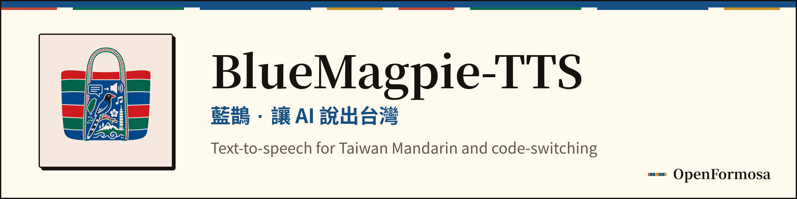
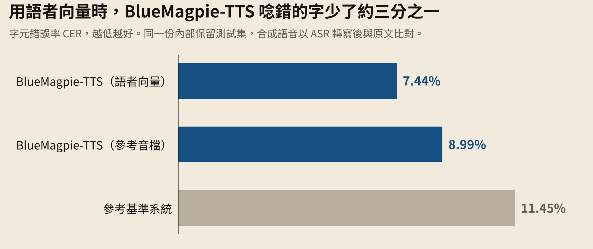

<p align="center"></p>

# BlueMagpie-TTS

BlueMagpie-TTS 是給台灣華語與中英夾雜句子用的開源文字轉語音模型，輸出 48 kHz 語音。在同一份內部測試集上，它的字元錯誤率是 7.44%，參考基準系統是 11.45%。

<p align="center">
  <a href="#授權"></a>
  <a href="https://huggingface.co/OpenFormosa/BlueMagpie-TTS"></a>
  <a href="https://huggingface.co/spaces/voidful/BlueMagpie-TTS-Demo"></a>
  
  <a href="https://discord.gg/N4YnrjjcW7"></a>
</p>

<p align="center"><b>繁體中文</b> · <a href="README.en.md">English</a></p>

<p align="center">
  <a href="https://huggingface.co/spaces/voidful/BlueMagpie-TTS-Demo">線上試用</a> · <a href="https://colab.research.google.com/github/OpenFormosa/BlueMagpie-TTS/blob/main/notebooks/BlueMagpie_TTS_Colab.ipynb">Colab</a> · <a href="https://huggingface.co/OpenFormosa/BlueMagpie-TTS">模型</a> · <a href="docs/">文件</a> · <a href="https://openformosa.com/community/">社群</a>
</p>

## 為什麼做這個

台灣人說話常常中英夾雜，例如「這個 feature 明天上線」。許多語音合成模型遇到這種句子，會唸錯英文或停頓不自然。使用者只好先把句子改寫成全中文。

BlueMagpie-TTS 直接處理這類句子。輸入原本的寫法就能唸。以內附語者向量合成時，每 100 個字唸錯的字從約 11 個降到 7 個。

專案全名是 OpenFormosa Blue Magpie TTS，取自台灣藍鵲（*Urocissa caerulea*）。藍鵲叫聲響亮、容易辨認，正好對應「把文字變成聲音」。

## 快速開始

不想在本機安裝，可以直接開 [Colab 筆記本](https://colab.research.google.com/github/OpenFormosa/BlueMagpie-TTS/blob/main/notebooks/BlueMagpie_TTS_Colab.ipynb)，用免費 GPU 跑完下面的步驟。

1. 安裝（需要 Python 3.10 到 3.12）：

   ```bash
   git clone https://github.com/OpenFormosa/BlueMagpie-TTS
   cd BlueMagpie-TTS
   pip install -e .
   pip install soundfile        # 存 .wav 檔用
   ```

2. 合成第一句話（第一次執行會自動下載約 8 GB 的模型）：

```python
import os
import torch
import soundfile as sf
from huggingface_hub import snapshot_download
from transformers import PreTrainedTokenizerFast
from bluemagpie import BlueMagpieModel

model_dir = snapshot_download("OpenFormosa/BlueMagpie-TTS")

# 直接從 tokenizer.json 載入 tokenizer，相容較新版 transformers（5.x）
tokenizer = PreTrainedTokenizerFast(tokenizer_file=os.path.join(model_dir, "tokenizer.json"))

device = "cuda" if torch.cuda.is_available() else ("mps" if torch.backends.mps.is_available() else "cpu")
model = BlueMagpieModel.from_local(model_dir, tokenizer=tokenizer, training=False, device=device)

# 用內附（已取得授權）的語者向量，第一次就能聽到穩定的音色
table = torch.load(os.path.join(model_dir, "checkpoints", "speaker_centroids.pt"),
                   map_location="cpu", weights_only=True)
centroid = table["centroids"][table["speaker_ids"].index("hung_yi_lee")]

audio = model.generate(
    target_text="你好，這是 BlueMagpie 合成的第一句話。",
    speaker_centroid=centroid,
    cfg_value=2.0,
)
sf.write("hello.wav", audio.squeeze().cpu().numpy(), model.sample_rate)
print("已寫出 hello.wav")
```

3. 打開 `hello.wav`，會聽到「你好，這是 BlueMagpie 合成的第一句話。」遇到問題先看[疑難排解](docs/troubleshooting.md)。

安裝時會自動從 GitHub 取得相依的 [`barbet`](https://github.com/OpenFormosa/Barbet) 套件，它負責文字語意。語音合成所需的聲學模組已內含在 `bluemagpie/_vendor/`，原始碼取自 [VoxCPM](https://github.com/OpenBMB/VoxCPM)，採 Apache-2.0 授權，不需另外安裝。

## 安裝

| 項目 | 需求 |
| --- | --- |
| Python | **3.10 – 3.12**（3.13 尚未支援） |
| 作業系統 | Linux、macOS（Windows 未經測試） |
| 主要相依套件 | PyTorch ≥ 2.1、transformers ≥ 4.44（5.x 亦可）、numpy ≥ 1.26 且 < 2.4 |
| 模型下載量 | 約 8 GB（首次執行自動下載） |
| Hugging Face 帳號 | **不需要**（模型公開、非 gated） |

| 硬體 | 支援 | 用法 | 速度參考* |
| --- | :-: | --- | --- |
| NVIDIA GPU（CUDA） | ✅ | `device="cuda"` | 最快 |
| Apple Silicon（MLX，選用） | ✅ | `pip install -e .[mlx]`，見〈[MLX 加速](docs/mlx.md)〉 | RTF ≈ 0.77（比即時快） |
| Apple Silicon（MPS） | ✅ | `device="mps"` | RTF ≈ 1.1 |
| CPU | ✅ | `device="cpu"`，見〈[在 CPU 上執行](#在-cpu-上執行)〉 | RTF ≈ 2.5 |

<sub>* RTF（real-time factor）＝合成 1 秒語音所需的運算秒數，小於 1 代表比即時快。數值為 `scripts/bench_rtf.py` 在 Apple M 系列、fp32 下實測，不同機器會有差異。</sub>

各介面的功能支援：

| 功能 | 單筆 `generate` | 串流 `generate_streaming` | 批次引擎 | MLX |
| --- | :-: | :-: | :-: | :-: |
| 一般合成 | ✅ | ✅ | ✅ | ✅ |
| 聲音複製（參考音檔） | ✅ | ✅ | ✅ | ✅ |
| 聲音複製／指定語者（語者向量） | ✅ | ✅ | ✅ | ✅ |
| 語音接續（prompt） | ✅ | ✅ | ✅（串流時僅回傳 latents） | ✅ |
| 自動重試（`retry_badcase`） | ✅ | — | — | — |

### 在 CPU 上執行

沒有 GPU 也能跑：載入時把 `device` 設為 `"cpu"`，其餘程式碼完全相同：

```python
model = BlueMagpieModel.from_local(model_dir, tokenizer=tokenizer, training=False, device="cpu")
```

- **速度參考**：RTF 約 2.5，合成 1 秒語音約需 2.5 秒運算（Apple M 系列實測；x86 依核心數而異）。一句十多個字的話，約十幾秒可完成。
- 長文建議切句逐段合成（搭配〈串流輸出〉），第一句能更快出聲。
- Apple Silicon 使用者建議改用〈[MLX 加速](docs/mlx.md)〉，比 CPU 快約 3.3 倍、比即時更快。

## 使用範例

| 功能 | 說明 | 在哪裡 |
| --- | --- | --- |
| 一般語音合成 | 直接把文字唸出來 | 下方〈基本使用〉 |
| 聲音複製（免逐字稿） | 給一段 3 秒以上的參考音檔，模仿該語者的音色 | [docs/voice-cloning.md](docs/voice-cloning.md) |
| 指定語者 | 用內附或自建的語者向量控制音色 | [docs/voice-cloning.md](docs/voice-cloning.md) |
| 語音接續 | 從一段既有語音與其文字接著唸下去 | 下方〈四種輸入模式〉 |
| 串流輸出 | 邊合成邊播放 | 下方〈串流輸出〉 |
| 批次推論引擎 | 多請求連續批次解碼，提升吞吐量 | [docs/batch-engine.md](docs/batch-engine.md) |
| Apple Silicon 加速 | MLX 原生推論，M 系列晶片上比即時更快 | [docs/mlx.md](docs/mlx.md) |

### 載入模型

**從 Hugging Face 下載**

```python
import os
from huggingface_hub import snapshot_download
from transformers import PreTrainedTokenizerFast
from bluemagpie import BlueMagpieModel

model_dir = snapshot_download("OpenFormosa/BlueMagpie-TTS")
# 直接從 tokenizer.json 載入 tokenizer，相容較新版 transformers（5.x）
tokenizer = PreTrainedTokenizerFast(tokenizer_file=os.path.join(model_dir, "tokenizer.json"))
model = BlueMagpieModel.from_local(model_dir, tokenizer=tokenizer, training=False, device="cuda")
```

模型是公開的，下載不需要 token 或申請權限。

**從本機目錄載入**

如果你已經有一份模型檔案，直接指向該目錄即可：

```python
import os
from transformers import PreTrainedTokenizerFast
from bluemagpie import BlueMagpieModel

model_dir = "checkpoints/bluemagpie"
tokenizer = PreTrainedTokenizerFast(tokenizer_file=os.path.join(model_dir, "tokenizer.json"))
model = BlueMagpieModel.from_local(model_dir, tokenizer=tokenizer, training=False, device="cuda")
```

- `device` 可填 `"cuda"`、`"mps"` 或 `"cpu"`，不指定時會自動選擇。
- 推論時請固定使用 `training=False`。

### 基本使用

`generate` 會回傳一段語音波形（`torch.Tensor`），搭配 `soundfile` 即可存成 `.wav`。輸出的取樣率可由 `model.sample_rate` 取得：

```python
import soundfile as sf

audio = model.generate(
    target_text="今天天氣真好。",
    cfg_value=2.0,
)

sf.write("output.wav", audio.squeeze().cpu().numpy(), model.sample_rate)
```

### 串流輸出

需要邊合成邊播放時，改用 `generate_streaming`。它是一個產生器，會一段一段地回傳音訊區塊：

```python
chunks = []
for chunk in model.generate_streaming(target_text="今天天氣真好。"):
    chunks.append(chunk)
    # 這裡可以即時播放或寫出 chunk
```

> 注意：串流模式下不支援自動重試（`retry_badcase`）。

### 四種輸入模式

模型支援四種輸入組合，皆透過同一個 `generate` 介面切換：

| 模式 | 需要的參數 | 用途 |
|---|---|---|
| 一般合成 | `target_text` | 直接把文字唸出來 |
| 語音接續 | `target_text`、`prompt_text`、`prompt_wav_path` | 從一段已有的語音與其文字接著往下唸 |
| 參考音檔 | `target_text`、`reference_wav_path` | 模仿參考音檔的語者音色（免逐字稿） |
| 語者向量 | `target_text`、`speaker_centroid` | 以語者向量複製音色 |

### `generate` 常用參數

| 參數 | 預設值 | 說明 |
|---|---|---|
| `target_text` | （必填） | 要合成的文字 |
| `prompt_text` | `""` | 提示文字，搭配 `prompt_wav_path` 做語音接續 |
| `prompt_wav_path` | `""` | 提示音檔路徑，用於語音接續 |
| `reference_wav_path` | `""` | 參考音檔路徑，用於聲音複製 |
| `speaker_centroid` | `None` | 語者向量，用於指定音色 |
| `cfg_value` | `2.0` | 引導強度，數值越大越貼合條件、但可能較不自然（建議 2.0–2.8） |
| `inference_timesteps` | `10` | 取樣步數，越多通常品質越好、速度越慢 |
| `min_len` / `max_len` | `2` / `2000` | 輸出長度的下限與上限 |
| `retry_badcase` | `False` | 偵測到異常輸出時自動重試（串流模式不支援；離線批次合成建議開啟） |

### 適合的應用

BlueMagpie-TTS 適合需要「台灣的聲音」的情境：

- **有聲內容**：新聞、部落格、電子報轉成有聲版。長文可以批次或串流合成。
- **客服與語音介面**：IVR 提示音、對話系統回覆。中英夾雜的產品名或英文縮寫不必改寫就能唸。
- **無障礙應用**：以自然的台灣華語朗讀網頁與文件。
- **研究與教學**：推論程式碼完整開源（含批次引擎與 MLX 移植），適合作為語音合成研究與課程的基礎。

## 效果

以下數字來自模型的內部保留測試集，隨 checkpoint 發佈於 [`release_metadata.json`](https://huggingface.co/OpenFormosa/BlueMagpie-TTS/blob/main/release_metadata.json)。評測方式：把合成語音用 ASR 轉寫回文字，再與原文比對。

| 系統 | 條件 | CER ↓ | WER ↓ |
| --- | --- | ---: | ---: |
| **BlueMagpie-TTS** | 語者向量（centroid） | **7.44%** | **8.57%** |
| **BlueMagpie-TTS** | 參考音檔（免逐字稿） | 8.99% | 11.77% |
| 參考基準系統 | 同一測試集 | 11.45% | 14.83% |

<p align="center"></p>

**怎麼讀這些數字**：

- **CER（字元錯誤率）**＝合成語音轉寫回文字後，與原文不一致（唸錯、漏唸、多唸）的字元比例；**WER** 是詞層級的同一概念。越低越好。
- 以語者向量條件為例：CER 從基準的 11.45% 降到 7.44%，**相對降低 35%**。直觀來說，每合成 100 個字，唸錯的字從約 11 個降到 7 個。
- 對想採用的團隊而言：同樣的素材，需要人工重聽、重錄的比例大約可以少三分之一。

長文合成診斷（同一 checkpoint）：

| 指標 | 數值 | 說明 |
| --- | ---: | --- |
| 語者向量 CER／WER | 7.51% | 長文逐段合成後的整體評測 |
| 參考音檔 CER／WER | 8.92% | 同上 |
| 語速 | 約 4.0 字/秒 | 接近自然朗讀速度 |
| 跨段落語者相似度下降 | 0.109 | 參考音檔模式下，長文各段音色一致性的損失 |

> 這是內部模型選擇用的評測、並非公開基準；換用不同的 ASR 或測試集，絕對數字會不同，請以「同條件下的相對比較」為主。

## 文件

- [聲音複製與指定語者](docs/voice-cloning.md)
- [批次推論引擎](docs/batch-engine.md)
- [Apple Silicon MLX 加速](docs/mlx.md)
- [疑難排解](docs/troubleshooting.md)
- [從 Hugging Face 使用模型](docs/從_HuggingFace_使用模型.md)
- [English usage guide](USAGE.md)

## 限制

- 合成的語音可能不完美。正式使用前請人工檢視。
- 請只使用你已取得授權的聲音。不要在未經本人同意下複製他人聲音。
- 請妥善保管語者向量表與合成出來的音檔，未經授權前不要對外散布。
- 聲音複製（`reference_wav_path`）需要 `step_0006000`（2026-07）之後的 checkpoint。
- 串流模式不支援自動重試（`retry_badcase`）。
- 上面的範例都直接從 `tokenizer.json` 載入 tokenizer 再傳給 `from_local`，在 transformers 5.x 也能穩定運作。原因見[疑難排解](docs/troubleshooting.md)。

## 參與貢獻

OpenFormosa 是社群專案，每個人都可以是貢獻者。BlueMagpie-TTS 特別歡迎以下合作：

- **語者授權**：擴充台灣在地語者，以及台語、客語方向的延伸。
- **部署試點**：有實際情境想採用 TTS 的團隊，歡迎交流需求與使用回饋。
- **開發貢獻**：效能最佳化、硬體支援、文件改進。

聯絡方式：

- 討論與提問：[Discord](https://discord.gg/N4YnrjjcW7)、[社群頁](https://openformosa.com/community/) 或 [Hugging Face 討論區](https://huggingface.co/OpenFormosa/BlueMagpie-TTS/discussions)
- 回報問題或提議功能：[Issues](https://github.com/OpenFormosa/BlueMagpie-TTS/issues)
- 送出修改：請先讀 [CONTRIBUTING.md](https://github.com/OpenFormosa/openformosa.com/blob/main/CONTRIBUTING.md)
- 一般聯絡：<hello@openformosa.com>
- 安全問題：<security@openformosa.com>（請不要公開發 issue）
- 行為準則：[CODE_OF_CONDUCT.md](https://github.com/OpenFormosa/openformosa.com/blob/main/CODE_OF_CONDUCT.md)，回報請寄 <conduct@openformosa.com>

## 授權

本 repository 的程式碼與文件以 [Apache License 2.0](LICENSE) 釋出，© 2026 OpenFormosa contributors。`bluemagpie/_vendor/` 內取自 VoxCPM 的程式碼同為 Apache-2.0。

BlueMagpie V1 的模型權重與內附語者向量依 [Hugging Face 模型卡](https://huggingface.co/OpenFormosa/BlueMagpie-TTS)的條款使用，內附語者向量僅限非商用。這部分不在 Apache License 2.0 範圍內。

## 致謝

本專案的運算資源與研究支持來自 Taipei-1、臺大語音實驗室（NTU Speech Lab）與 NTU SPML Lab。感謝提供語者授權的語者，也感謝每一位提出問題、送出 PR 與參與討論的貢獻者。

## 引用

```bibtex
@misc{openformosabluemagpie2026,
  title  = {BlueMagpie-TTS: Text-to-Speech for Taiwan Mandarin and Code-Switching},
  author = {{OpenFormosa contributors}},
  year   = {2026},
  url    = {https://github.com/OpenFormosa/BlueMagpie-TTS}
}
```
